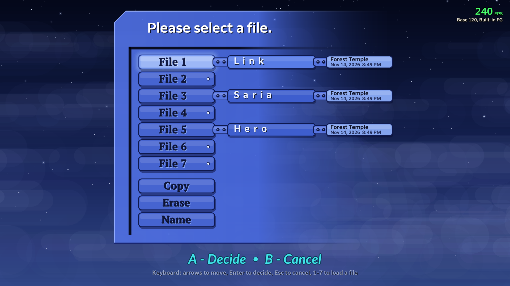

# Save Profiles

An N64-style file select with **7 files** for the Longshot game of
[Squadala!](https://github.com/daurosk/oot-remake-multiplayer), the OoT co-op kit. Each file is its own game: its own
saves, settings and progress. Choose Continue on the title and the file select comes in, as the game's own screens
do. Pick a file and the game opens that file's list of saves. B on that list brings the file select back, and B in the
file select goes back to the title, so you can switch files without a restart.



It is a co-op **code mod** (`mod.json` and `save_profiles.dll`) in the game's `mods\save-profiles` folder. The idea
and the `perfil<N>` folders come from [zelda-oot-perfis](https://github.com/juvxncio/zelda-oot-perfis) by juvxncio.
That mod is a Switch code patch, which Longshot cannot load, so this is a new implementation on the co-op module's
mod interface. It is a community mod, not part of the kit.

## Installing

1. Download `save-profiles-<version>.zip` from [Releases](../../releases).
2. Close the game. Unzip it into the game's `mods` folder, the one next to `longshot.exe`. In a kit that is
   `hookshot\game\mods`, so you end up with `hookshot\game\mods\save-profiles\mod.json`.
3. Start the game and choose Continue on the title: the file select comes up.

To take it out, delete `mods\save-profiles`. The file you played last stays in the save folder, and the game keeps
using it (see [Building from source](#building-from-source) for getting the other files back).

Any kit whose co-op module loads code mods works (mod interface version 1 or later).

- **Mod interface version 2 (co-op 0.11.5 and later):** the file select opens from the title's Continue, a pick opens
  the game's save list, and B on that list comes back to the file select.
- **Mod interface version 3 (`play_sound` and `focused_ready`, a co-op build after 0.11.5):** the game's own menu sounds (Continue's,
  a cursor step, a choice), and the title's first A brings the title's menu in, as the game has it, instead of opening
  the file select. Without them everything works the same, silently, and the first A on the title opens the file
  select.
- **Version 1:** the file select shows when the game starts, before the title, and the title comes up after a pick,
  as in Save Profiles 1.0.

## Why updates don't break it

- **No change to Longshot or to the kit.** Nothing is patched or rebuilt. `Update.bat` and `Revert.bat` only
  replace the files listed in the kit's `MANIFEST.txt`. The game's `mods` folder is not in it, and a Longshot rebuild
  keeps the game's `mods` and `user` folders.
- **It only uses what co-op keeps stable for its own features.** It relies on the co-op mod interface
  (`coop_mod_api.h`, versions 1 and 2, which only ever grow), co-op's export for the save folder's path, and co-op's
  controller reading. It never calls the game's code by address: version 2 names the screens and the button choice.
- **It degrades instead of breaking.** If a future build drops one of those, the mod logs it and steps aside; the
  game plays its save folder as it always did.

## Using it

| | Controller | Keyboard | Mouse |
|---|---|---|---|
| Move | D-pad or left stick | Up / Down (W / S) | point at a file or button |
| Decide | A (or +) | Enter | left click |
| Back | B | Esc | right click |
| Load a file directly | | 1 to 7 | |

- **Pick a file** to play it. The game's list of that file's saves opens (its newest save and its autosaves), as if
  you had chosen Continue on the title. **B** goes back to the title and keeps the file you played last; the cursor
  always starts on it.
- **B on the game's save list** brings the file select back, over the title. Pick another file and the game reads
  that file's saves and opens its list; B in the file select goes back to the list of the file you had.
- An empty file has no saves to list: the title comes up, and New Game starts it.
- **A new file:** picking an empty file asks for its name first, as on the N64. "End" with no name loads it
  unnamed.
- **Copy** asks which file, then where to.
  - Onto an empty file it copies straight away, with the name.
  - Onto a file that has saves it asks "Overwrite File N?" with Quit preselected. On Yes, that file's old saves move
    to `profiles-backup\overwritten-file<N>-<date>` first.
- **Erase** asks which file, then "Are you sure?" with Quit preselected. The file and its name are gone from the
  list, and its saves move to `profiles-backup\erased-file<N>-<date>`, so a mistake can be undone by hand.
- **Name** asks which file, then opens the name screen (up to 12 letters).
- **Mods tab:** in the game's menu (F1, or Home on a controller), go to Mods, then Save Profiles. "Skip the file
  select" is for co-op without mod interface version 2, where the file select shows at the start: on, the game opens
  the file you played last without asking. With version 2 the file select shows only when you choose Continue.
- Each Nucleus Coop window only listens to its own controller (`LICHII_COOP_PAD` in its `coop-options.ini`). If
  that controller is not connected, every controller works, so the picker can never get stuck.

### The name screen

| | Controller | Keyboard |
|---|---|---|
| Move on the letters | D-pad or left stick | arrows |
| Type the letter | A | type it (Shift or Caps Lock for capitals) |
| Space | Y, or Space on the screen | Space |
| Delete a letter | B (with none left: back out) | Backspace |
| Done | + or End on the screen | Enter |
| Cancel | B on an empty name | Esc |

Names use letters, digits, space and `- . '`. The co-op mod interface passes keys, not typed characters, so there
are no accents or other symbols.

## Other mods

- **Texture, model, text and HUD mods** (RomFS mods in the game's `mods` folder, such as a classic HUD) work
  together with this one.
  - They change what the game loads from its files. This mod changes only which save folder the game reads, and draws
    its own screen.
  - Nothing in a save depends on those mods, so every file works with them on or off.
- **Other co-op code mods** run alongside it; each has its own slot in the Mods tab.
- **The randomizer (Mods tab):** each file is its own save, so one file can hold a randomizer run and another a
  normal game. The randomizer's on/off switch and seed are the Mods tab's, for every file alike: turn it on or off
  before you pick the file it belongs to.
- **Switch code mods (`exefs`, `subsdk`, `.ips`)**, like the emulator version of zelda-oot-perfis or sloperina-based
  mods, never load on Longshot, with or without this mod. On the emulator, zelda-oot-perfis cannot be combined with
  other code mods. This one has no such limit.

## Multiplayer

- Nothing new is sent between players. The chosen file **is** the game's save folder, so co-op shares it exactly as
  it shares a save today:
  - A guest that joins asks the host for its save and gets the newest one from the host's chosen file.
  - When the host loads that file, co-op pushes it to every guest after the next save point.
- Guests keep playing the host's save from `<save folder>-coop` as before. Their own files are never written by a
  session.
- The file is chosen before co-op notes which folder is "your save", and is never switched mid-game, so the host
  never shares the wrong file. While co-op is hosting or joining at the title, the mod does not open the save list for
  you: the title is yours.
- **Two game windows on one PC** (Nucleus Coop) share one save folder. Moves are locked against each other. Once one
  window is playing a file, the other cannot swap it out: it shows "File N is open in the other game window" and
  offers that file.

## Where the files are

The game's save folder is `hookshot\game\user\save\5a3c9e1f0b7d24680000000000000001\`:

```
account.sav, option.sav, slot_00 ... slot_05   the file you are playing, as without this mod
perfil1\ ... perfil7\                         the other files, parked (only the ones that hold something)
profiles.txt                                  which file is in the save folder now (active=N), the names (name<N>=)
profiles-backup\<date>\                       the save folder as it was before the first switch ever
profiles-backup\erased-file<N>-<date>\        erased files
profiles-backup\overwritten-file<N>-<date>\   a file's saves from before a copy over it
```

- **Coming from the emulator mod:** copy the emulator's save folder here, including its `perfil2` ... `perfil7`
  folders. With no `profiles.txt`, the top of the folder counts as File 1, the same as zelda-oot-perfis does. Only
  Files 1 to 7 are offered.
- **Interrupted switches:** a switch writes `moving=A>B` into `profiles.txt` first. If the game closed in the middle,
  the next start finishes it.

## How it works

With mod interface version 2:

1. The mod sees the game's menu screens. While the title's Continue is focused (and, with `focused_ready`, its menu
   takes input), the mod keeps A and + from the game; your press opens the file select over the title instead, with
   Continue's own sound, and the game gets no input while it shows.
2. A pick moves the chosen file into the save folder (the game is idle at the title), has the game read its save list
   again from the save folder, and has the game choose Continue (the game's own button choice, not a pressed button),
   so the game's save list opens.
3. While that list or its question is up, the title stays the game's. When the list closes with no save loaded and the
   title takes input again, B took you back: the file select comes up again.
4. The file select's sounds are the game's own (`play_sound`), started on the title it is drawn over.

With version 1 (as in Save Profiles 1.0):

1. Code mods start at the game's first frame. That is before the game's save thread (`gmd::SaveDataMgr`) reads
   anything; this was measured with Longshot's file trace (`HOS_FS_TRACE=1`).
2. The mod pauses only that thread, while it is idle, and draws the file select over the game.
3. When you decide, it moves the chosen file into the save folder and lets the thread go. The game reads that file
   as if it were the only one.
4. If the game stops drawing while it waits for its saves, the mod lets the thread go after 4 seconds. The game
   then plays the file that is there, so it can never hang.

The log (`hookshot\game\logs\longshot_log.txt`) has every step on lines starting `coop: mod save-profiles:`.

## Building from source

- `build.cmd "C:\path\to\the kit"` builds `mod\save_profiles.dll` with the clang the kit already downloaded for
  Longshot (`hookshot\tools\llvm-mingw`). With no path it uses the folder above this one as the kit, then `%CC%`, then
  a MinGW-w64 clang or gcc on `PATH`. Releases are built with the kit's llvm-mingw clang.
- `install.cmd "C:\path\to\the kit"` copies the mod into the game's `mods\save-profiles`. Run it again after a
  rebuild, or if the kit ever builds a brand-new game folder.
- `install.cmd "C:\path\to\the kit" -Uninstall` takes the mod out:
  - The file you played last stays in the save folder, and the game keeps using it.
  - To get another file back without the mod: close the game, move the contents of the save folder into an empty
    `perfil<N>`, then move the contents of the `perfil<N>` you want up into the save folder.
- `src\coop_mod_api.h` is a copy of the co-op project's `hookshot/src/coop_mod_api.h` (version 3, unchanged). The mod reads the version at its start and uses version 2's and 3's entries only when the
  co-op it runs on has them (its `version`, and the table's and the screen's `size`).

## The letters

The buttons and the name keyboard use **PT Serif Bold**, and the footer uses **Lato Bold Italic**, as close as open
fonts get to the N64's. Both are in `mod\fonts` and are installed with the mod.

- The co-op mod interface draws text in the overlay's one font only. The mod reaches Longshot's own draw table, which
  co-op passes along, to load these two fonts.
- It uses that table only when it checks out: the same picture size, and its calls pointing into loaded program code.
- If a future build changes that, the letters fall back to the overlay's font. Nothing else changes.
- The game's log says which letters it drew with: `coop: mod save-profiles: letters: ...`.

## Licence

GPL-3.0-or-later, the same as the co-op kit (full text: [LICENSE](LICENSE)).
`src\coop_mod_api.h` is the co-op project's header (GPL-3.0-or-later).

The fonts are under the SIL Open Font License 1.1 and are unmodified. The licence texts are in `mod\fonts`:
- PT Serif (c) 2010 ParaType Ltd., reserved font name "PT Serif": `OFL-PTSerif.txt`.
- Lato (c) 2010-2014 Łukasz Dziedzic: `OFL-Lato.txt`.
